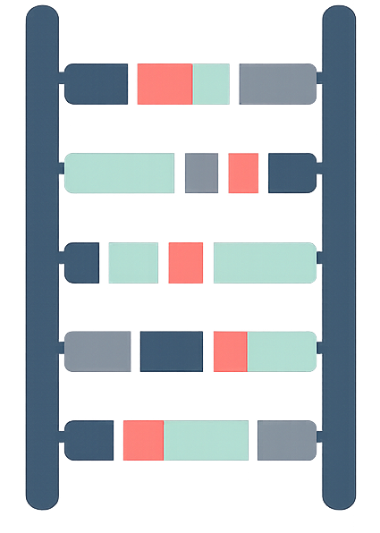

  

# Phase Ladder Plot

**Web version:** [https://keio-cmg.jp/PhaseLadderPlot/](https://keio-cmg.jp/PhaseLadderPlot/)

## Overview

Phase Ladder Plot is a tool that takes a phased VCF file (a VCF file with PS tags) as input and visualizes phase blocks along the chromosomes.

## About the input file (VCF with PS tags)

VCF files that have gone through a phasing step during analysis carry PS tags. Examples include the VCF files produced by typical long-read sequencing (ONT and PacBio) analysis pipelines.

Short-read VCF files do not carry PS tags, but PS tags can be added afterwards with phasing software such as [WhatsHap](https://whatshap.readthedocs.io/).

- Reference genome: hg38 (GRCh38)
- Format: uncompressed `.vcf` or gzip-compressed `.vcf.gz`

## Usage

### 1. Use the web version

Open [https://keio-cmg.jp/PhaseLadderPlot/](https://keio-cmg.jp/PhaseLadderPlot/) in a web browser, then drag and drop a VCF file onto the page (or select it with the file picker).

### 2. Use it locally

1. Download the whole repository (green **Code** button → **Download ZIP**, or `git clone https://github.com/medicalbioinfo/PhaseLadderPlot.git`).
2. Unzip it and open **`index.html`** in a web browser to use Phase Ladder Plot.

No installation or server is required. `index.html` also loads `phase-blocks.js`, `vendor/`, and `assets/` from the same folder, so keep the folder structure unchanged.

## Example data

`Example_HG002_Nanopore_UltraLong.vcf.gz` is an example VCF file for visualization with Phase Ladder Plot. As the file name indicates, it was obtained in house from Oxford Nanopore Technologies (ONT) ultra-long-read sequencing analysis of DNA from the HG002 sample.

Because the file (about 279 MB) exceeds GitHub's per-file size limit, it is distributed as a release asset rather than in the repository itself. Download it from the [Releases page](https://github.com/medicalbioinfo/PhaseLadderPlot/releases/latest):

- [`Example_HG002_Nanopore_UltraLong.vcf.gz`](https://github.com/medicalbioinfo/PhaseLadderPlot/releases/latest/download/Example_HG002_Nanopore_UltraLong.vcf.gz) (about 279 MB)
- [`Example_HG002_Nanopore_UltraLong.vcf.gz.tbi`](https://github.com/medicalbioinfo/PhaseLadderPlot/releases/latest/download/Example_HG002_Nanopore_UltraLong.vcf.gz.tbi) (tabix index; not required by Phase Ladder Plot)

## Privacy

VCF files are processed only within your browser and are never uploaded to any external server (this also applies to the web version).

## Files

| File | Description |
|---|---|
| `index.html` | Main application (user interface, plotting, VCF loading) |
| `phase-blocks.js` | Phase-block segmentation and statistics (N50, NG50, etc.) |
| `vendor/pako.min.js` | [pako](https://github.com/nodeca/pako), used to decompress `.vcf.gz` (MIT / Zlib license) |
| `assets/PhaseLadderPlot_icon.png` | Icon |

## Citation

Details will be described in a forthcoming bioRxiv preprint (Qian E, Kosaki K, Miya F. bioRxiv 2026). A link will be added here once it is available.
